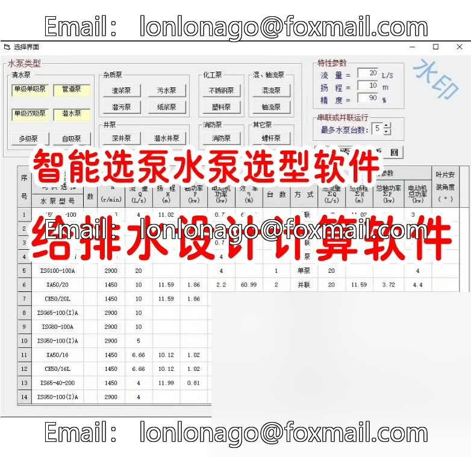
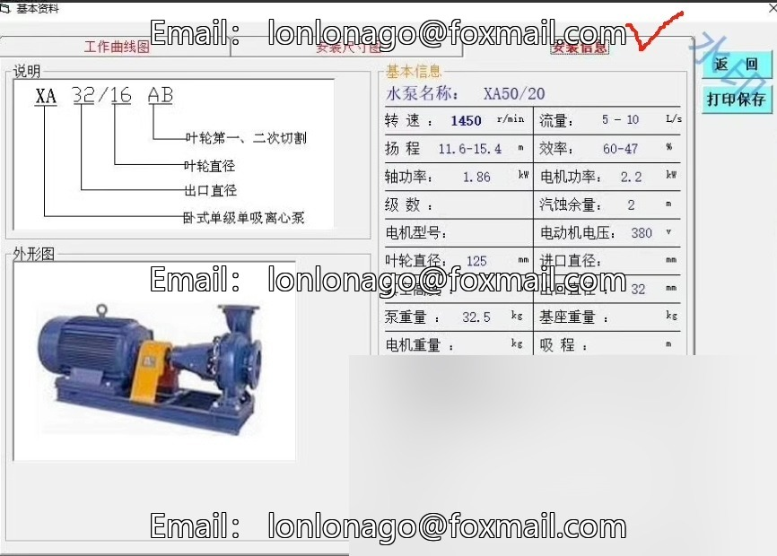
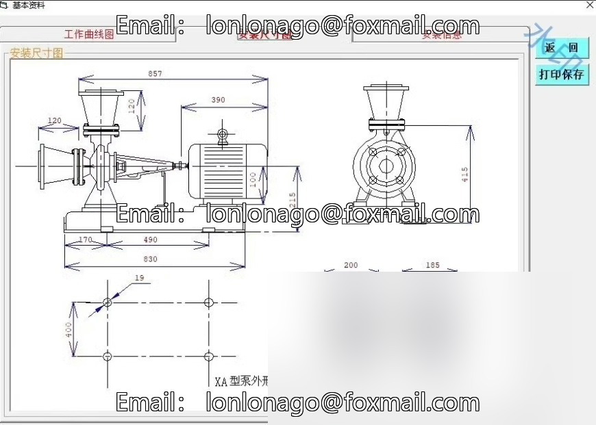
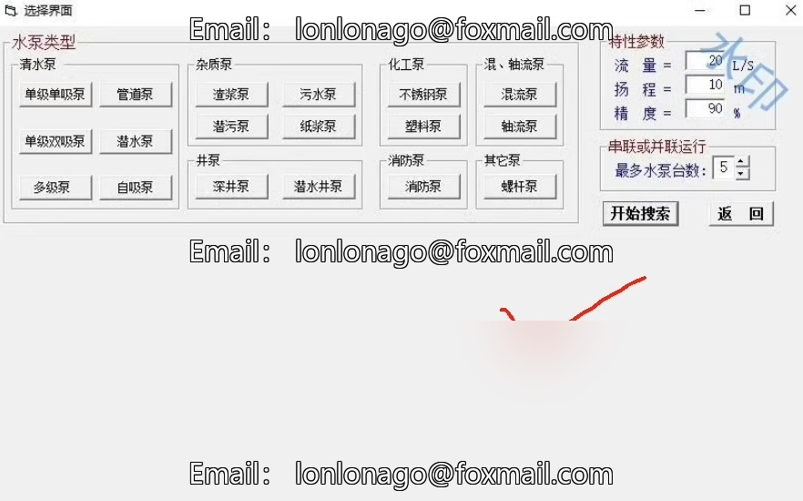

# Intelligent pump selection water pump selection software, water and drainage design calculation software, designed for engineering technical personnel and personnel.

## Body

Intelligent pump selection software for pumps, drainage and water supply design and calculation software An application designed for engineering technical personnel and pump enthusiasts Aims to simplify the selection process for pumps. Improve work efficiency.

Software function introduction: First, determine one or several types of water pumps (chemical pumps, clean water pumps, sewage pumps, axial flow pumps, well pumps, etc.), then input parameters such as flow rate, head, and precision in the software. The software can select all conforming water pumps, click the desired pump, and display its characteristic operating curve, installation size diagram, and related parameters.

online trading, and direct ordering allows immediate shipping.
I am online at long-term and will ship immediately.

The software supports smart pump selection for water and drainage design, allows inputting flow, head and accuracy for different pump types, and displays characteristic parameters, work curves, installation size charts and related information.

<!-- AI_ENRICHED -->

## Images

## Payment

Here is a pay link on Stripe ( https://buy.stripe.com/3cs8yP7sY87d0vu9AB ). Please contact me lonlonago@foxmail.com after funding $89, and I will send you a complete data files , thank you!

